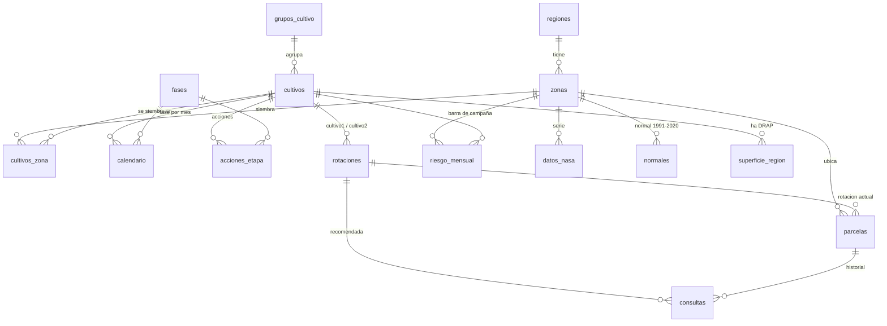

# Modelo relacional de la base de datos — AllpaShift (v2, 2026-11-14)

> PostgreSQL 17 en Docker (VPS Hetzner). Archivos: `04. base de datos/ddl/00-schema.sql` (estructura), `ddl/seed/01-catalogo-norte.sql` (datos) y `ddl/99-resumen.sql`.
> Se carga con `database-deploy.bat create --force`. El seed es **idempotente**: se puede volver a ejecutar sin duplicar.
> Respeta las 5 tablas del **Contrato del backend** (`cultivos`, `rotaciones`, `zonas`, `datos_nasa`, `consultas`), con los nombres en snake_case para Spring/JPA.

## 1. Esquemas

| Esquema | Para qué |
|---|---|
| `agro` | Territorio (regiones y valles), cultivos, calendario, acciones, rotaciones, parcelas, consultas y riesgo de campaña |
| `nasa` | Catálogo de datasets NASA, datos por punto y fecha, normales climáticas, eventos El Niño y caché de las APIs |
| `ref` | Referencias científicas para la sección *References* de la entrega |

## 2. Diagrama entidad-relación

## 3. Tablas

| Tabla | Clave | Contenido | Quién la llena |
|---|---|---|---|
| `agro.regiones` | `id`, `codigo` único | 7 regiones del norte (`piura`, `la_libertad`...) | Seed |
| `agro.zonas` ⭐ contrato | `id` | 18 valles: los 16 de David + Huarmaca y Ayabaca. Incluye `lat`, `lon`, `region`, `piso` (costa/sierra/selva), `cuenca`, `geojson` (polígono MIDAGRI, opcional) | Seed. Alejandro valida las coordenadas |
| `agro.grupos_cultivo` | `codigo` | cereal, menestra, frutal, hortaliza, tubérculo, industrial | Seed |
| `agro.cultivos` ⭐ contrato | `id`, `nombre` único | **37 cultivos**: rangos de temperatura y agua, `agua_necesaria` (baja/media/alta), Kc FAO-56, ciclo, fija nitrógeno, cobertura, raíz profunda, tolera sequía o inundación. `tipo` = anual/semipermanente/permanente, y `rota` (calculado: solo los anuales rotan) | Seed. Alejandro valida (`validado`) |
| `agro.cultivos_zona` | (cultivo, zona, campaña) | Qué se siembra en cada valle, `superficie_ha` y si es `principal` | Seed (DRAP) |
| `agro.superficie_region` | (cultivo, región, campaña) | Hectáreas por región (DRAP Piura 2025-2026) | Seed |
| `agro.fases` | `codigo` | S siembra · C crecimiento · F floración · K cosecha · D descanso o poda | Seed |
| `agro.calendario` | `id` | Fase de cada mes por cultivo y piso. `zona_id` NULL = calendario general; si tiene valor, es el calendario propio del valle | Seed |
| `agro.acciones_etapa` | `id` | Acciones por fase (generales con `cultivo_id` NULL, o propias de un cultivo), con la alerta NASA y el indicador | Seed y Alejandro |
| `agro.rotaciones` ⭐ contrato | `id` | `cultivo1_id`, `cultivo2_id`, `cultivo3_id` opcional, piso, beneficios y sacrificios | Seed y Alejandro |
| `agro.parcelas` | `id` | Parcela del agricultor: punto, valle, área, cultivo y rotación actual, fecha de siembra | App |
| `agro.consultas` ⭐ contrato | `id` | `lat`, `lon`, `fecha`, `rotacion_recomendada_id`, más la zona, la parcela, los `indicadores` y el `resultado` (JSONB) | Java (historial) |
| `agro.riesgo_mensual` | (zona, cultivo, año, mes) | Barra **"Perspectiva de la campaña"**: nivel verde/ámbar/rojo, puntaje y motivo | Java con climate-service |
| `nasa.datasets` | `codigo` | 10 datasets con versión, DOI, proveedor, resolución y si piden login | Seed |
| `nasa.datos_nasa` ⭐ contrato | `id` | Formato del CSV de David (`lat, lon, fecha, fuente, variable, valor`), más `version` y `zona_id`. Se carga con `\copy` | David (ETL) |
| `nasa.normales` | (zona, variable, mes, periodo) | Normal 1991-2020 por valle | David |
| `nasa.eventos_enso` | `nombre` | El Niño 1997-98, Niño Costero 2017 y 2023, El Niño 2026-27 | Seed |
| `nasa.respuesta_cache` | (fuente, clave) | Caché JSON de las APIs | Servicios |
| `ref.referencias` | `doi` | Papers y datasets citados, con la ruta del PDF | Edwin |

## 4. Vistas con la forma del contrato

- **`agro.v_cultivos_contrato`**: `id, nombre, temp_min_c, temp_max_c, agua_necesaria, meses_siembra[], meses_cosecha[], acciones_por_etapa (JSON por fase)`, más `grupo` y `tipo`. Java la lee y la convierte a camelCase (`tempMinC`, `mesesSiembra`, `accionesPorEtapa`...).
- **`agro.v_calendario_texto`**: cadena de 12 letras por cultivo y piso. Es lo que usa hoy el frontend (`'KDDDDDCFCKKK'` = uva de mesa).

## 5. Contenido cargado (VPS, 2026-11-14)

| Tabla | Filas |
|---|---|
| regiones | 7 |
| zonas | 18 |
| cultivos | 37 (6 cereales, 4 menestras, 11 frutales, 8 hortalizas, 4 tubérculos, 4 industriales; sandía y melón van en hortalizas) |
| cultivos_zona | 104 |
| calendario | 492 (41 calendarios × 12 meses) |
| acciones_etapa | 13 (5 generales + 8 de uva, mango, limón, arroz y banano) |
| rotaciones | 8 candidatas |
| datasets | 10 · eventos ENSO: 4 |

## 6. Reglas de diseño

1. **Los permanentes no rotan:** mango, limón, uva, banano, café y cacao reciben acciones por fase (propuesta del equipo, doc 23). La columna calculada `rota` lo impone.
2. **Contrato primero:** las 5 tablas del contrato conservan sus campos. Lo nuevo son columnas opcionales o tablas aparte, así que no rompe a Java ni a Python.
3. **Sin PostGIS por ahora:** los polígonos de los valles van en `geojson` (JSONB). Si se necesitan consultas espaciales, se activa PostGIS más adelante.
4. **Trazabilidad:** cada cultivo, superficie y dataset lleva su `fuente` (DRAP, MIDAGRI, FAO-56, CMR). Los datos NASA llevan `version`.
5. **Validación pendiente:** calendarios y Kc son **preliminares** (`validado = FALSE`) hasta que Alejandro los confirme.
