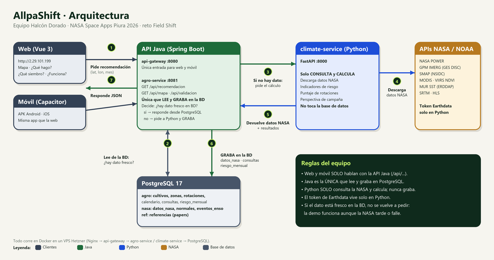

# Arquitectura y reglas de AllpaShift (obligatorias)

> Decisión de Jhonny (líder), 2026-11-14. Todo diseño y desarrollo debe cumplir estas reglas.
> Diagrama: `01. documentacion/img/arquitectura_allpashift.png`.

## Reglas

1. **Web y móvil SOLO hablan con la API Java** (`/api/...` a través del api-gateway). Nunca llaman directo a Python, a la NASA ni a la base de datos.
2. **Java (agro-service) es la ÚNICA que lee y graba en PostgreSQL.**
3. **Python (climate-service) SOLO consulta las APIs de la NASA y calcula.** Nunca lee ni graba en la base de datos.
4. **El token de Earthdata vive solo en Python** (`EARTHDATA_TOKEN`). Java no lo necesita.
5. **Primero la base de datos:** si el dato está fresco en PostgreSQL, Java responde desde ahí y no vuelve a pedirlo. Así la demo funciona aunque la NASA tarde o falle.

## Flujo de una consulta

| Paso | Quién | Qué hace |
|---|---|---|
| 1 | Web / móvil → api-gateway → agro-service | `GET /api/recomendacion?lat&lon&mesSiembra` (también `/api/mapa`, `/api/validacion`, `/api/cultivos`, `/api/asistente`) |
| 2 | agro-service → PostgreSQL | Lee: ¿hay datos NASA y un cálculo frescos para ese punto? Si los hay, salta al paso 7 |
| 3 | agro-service → climate-service | Pide el cálculo: envía el punto, la fecha y el catálogo (cultivos y rotaciones leídos de la BD) |
| 4 | climate-service → APIs NASA/NOAA | Descarga POWER, GPM IMERG, SMAP, MODIS/VIIRS, MUR SST, SRTM y HLS |
| 5 | climate-service → agro-service | Devuelve los **datos NASA crudos** (para guardarlos) y los **resultados**: indicadores, rotaciones, qué hacer, riesgo por mes |
| 6 | agro-service → PostgreSQL | Graba en `nasa.datos_nasa`, `agro.consultas` y `agro.riesgo_mensual` |
| 7 | agro-service → web / móvil | Responde el JSON con la forma del contrato (`types/api.ts` del frontend) |

## Responsabilidades

| Componente | Hace | No hace |
|---|---|---|
| **Frontend** (Vue 3, `03. frontend`) y **móvil** (Capacitor) | Muestra datos y llama a `/api/...` | Llamar a la NASA o a Python; guardar datos de negocio |
| **api-gateway** (Spring Cloud Gateway :8080) | Enruta `/api/...` | Lógica de negocio |
| **agro-service** (Spring Boot :8081) | Lee y graba en PostgreSQL, arma la respuesta, decide si el dato está fresco | Descargar de la NASA |
| **climate-service** (FastAPI :8000) | Descarga datos NASA y calcula riesgos, puntajes y perspectiva | Conectarse a PostgreSQL |
| **PostgreSQL 17** | Esquemas `agro`, `nasa` y `ref` (doc 26) | — |

## Frescura de los datos (propuesta)

- Diario reciente (POWER, IMERG, SMAP): **3 horas**.
- MUR SST: **6 horas**.
- Climatología (normales): **30 días**.
- Recomendación calculada por punto y mes de siembra: **3 horas**.

## Estado frente a las reglas (2026-11-14)

- ✅ Web → `/api/...` → agro-service → climate-service: funcionando en http://2.29.101.199.
- ⚠️ **Hoy agro-service descarga NASA POWER y MUR SST.** Hay que pasar esas descargas a climate-service (reglas 3 y 4).
- ⚠️ **Hoy no se graba nada.** Falta grabar en `nasa.datos_nasa`, `agro.consultas` y `agro.riesgo_mensual`, y leer primero de ahí (regla 5).
- ⚠️ La rama de David tiene una capa de base de datos en Python (`db/`). Solo puede usarse para pruebas locales; en el servidor Python no se conecta a PostgreSQL. Se quitará `DATABASE_URL` del climate-service en `docker-compose.app.yml`.
