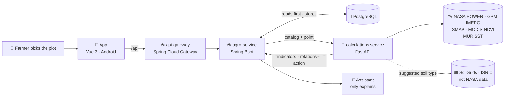

<div align="center">


<sub>Cover image generated with SI (ChatGPT) and marked as such.</sub>

### Plant for the climate ahead — with NASA satellite data

**NASA Space Apps Challenge 2026 · Challenge: _Field Shift: Adapting Farms with NASA Data_ · Local event: Piura, Peru**

[](https://www.spaceappschallenge.org/)
[](https://www.spaceappschallenge.org/)
[](#)
[](LICENSE)


[High-Level Summary](#summary) ·
[Project Demo](#demo) ·
[Final Project Link](#link) ·
[Project Details](#details) ·
[Use of AI / NASA Data](#ai-data) ·
[References](#references)

</div>

---

<a id="summary"></a>

## 🌱 High-Level Summary

**AllpaShift helps a farmer choose crop rotations that protect their soil and adapt to a changing climate: it combines NASA Earth observations with the farmer's own soil and priorities, and tells them what to do in the next two weeks, what to plant and when.**
*Allpa* means "land" in Quechua; *Shift* is the change the Field Shift challenge asks for.

**Why it matters.** In northern Peru, a single coastal El Niño can ruin a whole season: in **March 2017** the Piura region received about **5 times its normal rainfall** (GPM IMERG) and the Piura River overflowed. The warning signs were in the ocean weeks earlier, but they never reached the farmer in a form they could act on.

**How it answers the challenge.** Field Shift asks for *"a decision support tool that uses NASA Earth observations, along with local soil information, crop characteristics, and farmer priorities, to help farmers explore rotation strategies that could strengthen soil health and adapt their fields to changing conditions."* AllpaShift covers every part of it:

| The challenge asks for… | AllpaShift |
|---|---|
| **NASA Earth observations** | NASA POWER, GPM IMERG, SMAP, MODIS NDVI and MUR SST, with the dataset shown next to every value |
| **Local soil information** | Soil moisture from SMAP; soil type (sandy, loam, clay) and salinity entered by the farmer, with a suggested soil type from SoilGrids (ISRIC) that they can change |
| **Crop characteristics** | 37 crops: temperature range, water use, planting months, botanical family, root depth and salt tolerance |
| **Farmer priorities** | *"What matters most to you?"*: take less risk, save water or care for the soil. The recommended rotation changes with the answer |
| **Explore rotation strategies** | Three rotations compared side by side, always including the traditional one (e.g. rice–rice) |
| **Strengthen soil health** | A **soil score** for every rotation: legumes and alternating root depths add points; repeating the same crop or family, or thirsty crops on salty or sandy soil, take points off |
| **Adapt to changing conditions** | A **climate score** from NASA data: drought, extreme rain, heat and the coastal El Niño signal, month by month |

What the farmer sees:

| | Feature | What the farmer sees |
|:-:|---|---|
| ✅ | **What should I do now?** | One action for the next two weeks (plant, wait, irrigate, protect from heat, prepare drainage) and the NASA data point behind it |
| 🌾 | **What should I plant?** | Three crop rotations, each with a **climate score**, a **soil score** and a **final score** (0–100) weighted by what the farmer chose; every point added or deducted is shown and explained |
| 🧑‍🌾 | **Your soil and your priority** | The farmer marks their soil type and salinity (SoilGrids suggests the type) and what matters most to them; the app explains *"We recommend it because you chose to care for the soil"* |
| 📅 | **Season outlook** | Month-by-month risk from planting to harvest: 🟢 low · 🟡 medium · 🔴 high |
| 🌳 | **Perennial crops** | Mango, lime and banana get a 12-month plan by growth stage instead of rotations |
| 🗺️ | **Valley map** | Risk level for the valleys of Piura, and any place in the world |
| ⏳ | **Does it work?** | A "time machine" that replays the 2017 coastal El Niño with real data |

> **We don't predict the weather. We help farmers prepare for it.**
> Risk is estimated by comparing current NASA data with the historical normal and adding early signals such as El Niño.

---

<a id="demo"></a>

## 🎬 Project Demo

<div align="center">

[](https://www.youtube.com/watch?v=3UVyc3Y5eFw)

**[▶ Watch on YouTube](https://www.youtube.com/watch?v=3UVyc3Y5eFw)** · English subtitles available · <sub>Contains SI-generated scenes (Gemini).</sub>

**Slides (7, English):** [AllpaShift_Demo_EN.pdf](https://github.com/jramirezch1978/allpashift/blob/main/01.%20documentacion/entrega/AllpaShift_Demo_EN.pdf) · [AllpaShift_Demo_EN.pptx](https://github.com/jramirezch1978/allpashift/blob/main/01.%20documentacion/entrega/AllpaShift_Demo_EN.pptx)
<sub>Problem and challenge · NASA data · Solution · How it works · Demo with real screenshots · Impact (2017 validation)</sub>

</div>

---

<a id="link"></a>

## 🔗 Final Project Link

| | Link |
|---|---|
| 💻 **Source code** | https://github.com/jramirezch1978/allpashift |
| 🎬 **Demo video** | https://www.youtube.com/watch?v=3UVyc3Y5eFw |
| 🌐 **Live app** (team server, HTTPS) | https://allpashift.crisaor.org |
| 📱 **Android app** (APK 1.0.0, signed, release) | [allpashift-1.0.0.apk](05.%20mobile/release/android/allpashift-1.0.0.apk) |
| 🍎 **iOS project** (Xcode) | [allpashift-ios-xcode.zip](05.%20mobile/release/ios/allpashift-ios-xcode.zip) |

### 📄 Submission documents

| Document | What it covers | Link |
|---|---|---|
| 🌱 **High-Level Summary** | What AllpaShift is, why it matters and how it answers the challenge | [AllpaShift_Summary.pdf](https://github.com/jramirezch1978/allpashift/blob/main/01.%20documentacion/entrega/AllpaShift_Summary.pdf) |
| 🎬 **Project Demo** (7 slides) | The problem, NASA data, the solution, how it works, real app screenshots and the 2017 validation | [PDF](https://github.com/jramirezch1978/allpashift/blob/main/01.%20documentacion/entrega/AllpaShift_Demo_EN.pdf) · [PPTX](https://github.com/jramirezch1978/allpashift/blob/main/01.%20documentacion/entrega/AllpaShift_Demo_EN.pptx) |
| ⚙️ **Project Details** | How it works step by step, soil health and farmer priorities, tools and goals | [AllpaShift_Project_Details_EN.pdf](https://github.com/jramirezch1978/allpashift/blob/main/01.%20documentacion/entrega/AllpaShift_Project_Details_EN.pdf) |
| 🛰️ **Use of AI and NASA Data** | The six NASA datasets, how each is used, and where SI was used | [AllpaShift_AI_and_NASA_Data_EN.pdf](https://github.com/jramirezch1978/allpashift/blob/main/01.%20documentacion/entrega/AllpaShift_AI_and_NASA_Data_EN.pdf) |
| 📚 **References** | Data, papers, software and licenses | [AllpaShift_References_EN.pdf](https://github.com/jramirezch1978/allpashift/blob/main/01.%20documentacion/entrega/AllpaShift_References_EN.pdf) |
| 📱 **Mobile app guide** | How to install the Android APK and build the iOS app | [05. mobile/README.md](05.%20mobile/README.md) |
| 🔒 **HTTPS setup guide** (Spanish) | How the domain, Cloudflare and the certificate were set up from scratch, step by step | [AllpaShift_HTTPS_paso_a_paso.pdf](https://github.com/jramirezch1978/allpashift/blob/main/01.%20documentacion/AllpaShift_HTTPS_paso_a_paso.pdf) |
| 🔍 **Technical audit** (Spanish) | Final diagnosis of the live app: scores, findings and what was fixed | [AllpaShift_Diagnostico_Auditoria_261115.pdf](https://github.com/jramirezch1978/allpashift/blob/main/01.%20documentacion/AllpaShift_Diagnostico_Auditoria_261115.pdf) |

---

<a id="details"></a>

## ⚙️ Project Details

### How it works

1. The farmer picks their plot on the map (or shares their location), and can add their soil type, salinity and what matters most to them.
2. The app asks the **Java API**. If a fresh result is already in **PostgreSQL**, it answers from there.
3. If not, the Java API asks the **calculation service (Python)**, sending the crop catalog stored in the database (37 crops, 18 valleys, calendars and rotations).
4. The calculation service reads **NASA data** (NASA POWER, GPM IMERG, SMAP, MODIS and MUR SST) and computes indicators, the season outlook, the climate and soil score of each rotation, the final score for the farmer's priority and this fortnight's action.
5. The Java API stores the result and answers the app. An **assistant** explains it in plain words.



### Design rules

- **Rule-based, explainable calculations.** Every risk level, score and action comes from fixed, documented rules and thresholds (`02. backend/python/calculos/config/umbrales.yaml`). Assumptions made by the team, such as the soil points and the priority weights, are marked as such.
- **AI never decides.** The assistant only explains the result that was already calculated.
- **Data honesty.** Every value shows the dataset it really comes from. Soil type and salinity are labelled *"SoilGrids (ISRIC)"* or *"data you gave"*, never as NASA data. Missing data is shown as "no data", never filled in. If the app ever shows sample data, a fixed banner says *"Sample data – not real NASA data"*.
- **Works when the network is weak.** The Java API answers from the database first, and the app keeps the last recommendation for offline use.

### How a rotation is scored

Each rotation gets three scores from 0 to 100, all from fixed rules in `config/umbrales.yaml` (no AI):

| Score | Starts at | Rules (points) | Source |
|---|---|---|---|
| 🌦️ **Climate** | 100 | High-water crop with soil moisture or rain in deficit (−20/−40) · months outside the crop's temperature range (−10 each, max −30) · high-risk months in the season (−10 each) · planting out of season (−15) · extraordinary El Niño on the northern coast (−35) | NASA data |
| 🌱 **Soil** | 70 | Same crop twice (−30) · same botanical family (−15) · includes a legume, which fixes nitrogen (+15) · different root depths (+10) · cover crop (+5) · high-water crop on salty soil (−10/−20) · salt-sensitive crop on salty soil (−10/−20) · high-water crop on sandy soil (−10) | Crop catalog and the farmer's soil |
| 💧 **Water** | — | Low use 100 · medium 60 · high 20 | Crop catalog |

**Final score** = weighted mix according to the farmer's priority:

| Priority | Climate | Soil | Water |
|---|:-:|:-:|:-:|
| Take less risk (default) | 60 % | 25 % | 15 % |
| Care for the soil | 35 % | 50 % | 15 % |
| Save water | 35 % | 15 % | 50 % |

Example with real data (Piura, planting in December 2026): rice–cowpea scores 100 for soil and rice–rice 40; the recommended rotation is rice–cowpea when the farmer chooses *take less risk*, and cowpea–lablab bean when they choose *save water*. If a value is missing (for example a crop with no salt-tolerance data), that rule is simply not applied.

### Indicators

| Indicator | Current value | Compared with ("normal") | Dataset |
|---|---|---|---|
| 🌧️ Rainfall | Mean of the last 30 days | Same months, 2001–2020 (Piura) / 2001–2025 (worldwide) | GPM IMERG in Piura · NASA POWER elsewhere |
| 💧 Soil moisture | Mean of the last 30 days | Same days of the year, 2016–2025 (Piura) / same months, 2001–2025 (worldwide) | SMAP in Piura · NASA POWER elsewhere |
| 🌡️ Heat | Mean daily maximum, last 30 days | Same days of the year, 2001–2025 | NASA POWER (`T2M_MAX`) |
| 🌊 El Niño | Weekly sea surface temperature anomaly, Niño 1+2 box | MUR climatology 2003–2014 | MUR SST v4.1 |
| 🌿 Vegetation | Latest 16-day composite | Same composite, 2016–2025 | MODIS NDVI (Piura; informative, does not change the risk) |

### What we found with real data

- 🌊 **A coastal El Niño is under way:** the Niño 1+2 region is **+6.0 °C** above normal (MUR SST, week of 9 Nov 2026). We cross-checked it with NOAA CPC's weekly index (+5.6 °C, week of 4 Nov 2026).
- 🛰️ **Satellite vs. model:** for the last 30 days in Piura, NASA POWER (a model) shows 5 to 10 times more rain than GPM IMERG (satellite). That is why the app uses IMERG for rainfall in Piura.
- ⏳ **2017 replay:** with today's rules, the ocean would have given a first signal on **5 Dec 2016** (+0.6 °C) and the drainage alert on **16 Jan 2017** (+1.9 °C), about **6 weeks before** the March rainfall peak.

### Tools

| Part | Technologies |
|---|---|
| App (`03. frontend`) | Vue 3, TypeScript, Vite, Tailwind CSS, Pinia, vue-i18n (English/Spanish), Leaflet, Chart.js, Capacitor (Android) |
| API (`02. backend/java`) | Java 17, Spring Boot, Spring Cloud Gateway, JDBC, PostgreSQL |
| Calculations (`02. backend/python/calculos`) | Python 3.11, FastAPI, pandas, NumPy, httpx; earthaccess and xarray for the download scripts |
| Data & infrastructure | PostgreSQL, Docker, Nginx |
| Quality | Automated tests (pytest and JUnit) and a data-honesty check that runs before every app build |

### Goals

- Give smallholder farmers **one clear action** they can take this fortnight.
- Help them **explore rotations that rebuild the soil** (legumes, alternating roots) instead of repeating the same crop.
- Let them **decide by what matters to them**: less risk, less water or healthier soil.
- Make climate risk **visible before planting**, not after the loss.
- Show that NASA open data can be turned into **simple, trustworthy advice** that explains itself.

---

<a id="ai-data"></a>

## 🛰️ Use of AI / NASA Data

### NASA data

| Dataset | Version / product | Variables | How we use it |
|---|---|---|---|
| **NASA POWER** | API v2.10, Agroclimatology community | `PRECTOTCORR`, `GWETTOP`, `T2M_MAX`, `T2M_MIN` (daily and 2001–2025 climatology) | Current rainfall (outside Piura), soil moisture and heat anywhere in the world; monthly climate normals for the season outlook |
| **GPM IMERG** | V07: `GPM_3IMERGM` (Final, monthly) and `GPM_3IMERGDL` (Late, daily) | `precipitation` | Rainfall of the last 30 days for the Piura valleys; monthly rainfall and its 2001–2020 normal for the "Does it work?" replay |
| **SMAP** | `SPL3SMP_E` V006, Enhanced L3, 9 km (NASA NSIDC DAAC) | `soil_moisture` (AM and PM passes) | Soil moisture of the last 30 days for the Piura valleys, compared with the same days in 2016–2025 |
| **MODIS NDVI** | `MOD13Q1` V061, 250 m, 16-day composite (via ORNL DAAC web service) | `250m_16_days_NDVI` | Vegetation status of the Piura valleys, compared with the same composite in 2016–2025 (informative) |
| **MUR SST** | v4.1, NASA JPL PO.DAAC (via NOAA CoastWatch ERDDAP) | `analysed_sst`, `sstAnom` | Weekly sea temperature anomaly in the Niño 1+2 box: El Niño indicator, season risk on the northern coast and the 2017 alert date |
| **NASA GIBS** | Blue Marble Next Generation | True-colour imagery | Satellite base layer of the map |

Outside the Piura valleys, rainfall and soil moisture come from NASA POWER, and the app says so. The team also explored VIIRS NDVI, SRTM and HLS in the `climate-service` folder; **they are not used by the current app.**

**Partner and other open data:** NOAA CoastWatch ERDDAP (MUR SST access), NOAA CPC weekly Niño indices (cross-check), **SoilGrids 2.0 by ISRIC** (sand, silt and clay at 0–30 cm to *suggest* the soil type; CC-BY 4.0; the farmer can change it), FAO-56 and FAO Irrigation and Drainage Paper 29 (root depth and salt tolerance of the crop catalog), OpenStreetMap (map and place search), INDECI (summary of the 2017 impacts in Piura).

### Use of AI

| | |
|---|---|
| **In the app** | The assistant uses **Groq** with the model **`openai/gpt-oss-20b`** (Apache 2.0 license). |
| **What it does** | Explains, in up to four sentences and in English or Spanish, the recommendation that AllpaShift already calculated (including the soil score and why a rotation fits the farmer's priority), naming the source of each value. |
| **What it does not do** | It does not calculate, does not invent numbers, crops, dates or sources, does not change the recommendation and does not decide what to plant. |
| **Safeguards** | It only cites sources present in the calculated result. Empty or too-long answers are discarded. If the AI fails or takes more than 8 s, the app shows the calculated recommendation instead. The API key lives only on the server. |
| **During development** | AI coding assistants (Claude Code, by Anthropic) helped draft code, tests and documentation. All output was reviewed, run and verified by the team against the real data. |
| **Images and video** | **ChatGPT** (OpenAI) made the cover art, the Earth background and the app logo; **Gemini** (Google) made scenes of the demo video. They are illustrative, do not represent real data and are marked as *SI-generated*. |

---

<a id="references"></a>

## 📚 References

**NASA data**
- NASA Langley Research Center, POWER Project. *Prediction Of Worldwide Energy Resources (POWER) API v2.10*. https://power.larc.nasa.gov/
- Huffman, G. J., et al. (2023). *GPM IMERG Final Precipitation L3 1 month 0.1° × 0.1° V07 (GPM_3IMERGM)*. NASA GES DISC. doi:10.5067/GPM/IMERG/3B-MONTH/07
- Huffman, G. J., et al. (2023). *GPM IMERG Late Precipitation L3 1 day 0.1° × 0.1° V07 (GPM_3IMERGDL)*. NASA GES DISC. doi:10.5067/GPM/IMERGDL/DAY/07
- O'Neill, P. E., et al. *SMAP Enhanced L3 Radiometer Global Daily 9 km EASE-Grid Soil Moisture, Version 6 (SPL3SMP_E)*. NASA NSIDC DAAC. doi:10.5067/M20OXIZHY3RJ
- Didan, K. (2021). *MODIS/Terra Vegetation Indices 16-Day L3 Global 250m SIN Grid V061 (MOD13Q1)*. NASA LP DAAC. doi:10.5067/MODIS/MOD13Q1.061. Accessed via the ORNL DAAC MODIS Web Service.
- JPL MUR MEaSUREs Project (2015). *GHRSST Level 4 MUR Global Foundation Sea Surface Temperature Analysis (v4.1)*. NASA PO.DAAC. doi:10.5067/GHGMR-4FJ04. Accessed via NOAA CoastWatch ERDDAP (`jplMURSST41`, `jplMURSST41anom1day`).
- NASA Global Imagery Browse Services (GIBS). *Blue Marble Next Generation*. https://earthdata.nasa.gov/gibs

**Other data**
- NOAA Climate Prediction Center. *Weekly Niño indices (OISST v2.1)*. https://www.cpc.ncep.noaa.gov/data/indices/wksst9120.for
- OpenStreetMap contributors. Map data and Nominatim search, ODbL. https://www.openstreetmap.org/copyright
- INDECI (Instituto Nacional de Defensa Civil, Peru). Reports on the 2017 coastal El Niño.
- Poggio, L., et al. (2021). *SoilGrids 2.0: producing soil information for the globe with quantified spatial uncertainty*. SOIL 7, 217–240. doi:10.5194/soil-7-217-2021. ISRIC REST API, CC-BY 4.0. https://rest.isric.org
- Allen, R. G., Pereira, L. S., Raes, D., Smith, M. (1998). *Crop evapotranspiration (FAO Irrigation and Drainage Paper 56)*, Table 22: maximum root depth. FAO, Rome.
- Ayers, R. S., Westcot, D. W. (1985). *Water quality for agriculture (FAO Irrigation and Drainage Paper 29 Rev. 1)*, Table 4: crop salt tolerance. FAO, Rome.
- Crop catalog of northern Peru (crops, valleys, calendars and rotations): team database, `04. base de datos`.

**Software (all open source)**
- App: Vue, Vite, TypeScript, Tailwind CSS, Pinia, vue-router, vue-i18n, axios, Chart.js, vue-chartjs, Capacitor (MIT); Leaflet (BSD-2); Lucide icons (ISC); Inter and Bricolage Grotesque fonts (SIL OFL 1.1).
- API: Spring Boot, Spring Cloud Gateway (Apache 2.0); PostgreSQL JDBC driver (BSD-2).
- Calculations: FastAPI, Pydantic, PyYAML, earthaccess, netCDF4 (MIT); Uvicorn, httpx, pandas, NumPy, h5netcdf (BSD); xarray (Apache 2.0).
- AI: Groq API with `openai/gpt-oss-20b` (Apache 2.0).

---

## 🗂️ Repository structure

| Folder | Contents |
|---|---|
| `01. documentacion` | Project documentation (Spanish) |
| `02. backend/java` | `api-gateway` (8080) and `agro-service` (8081), Spring Boot |
| `02. backend/python/calculos` | Calculation service (8001): indicators, season risk, rotations, map and the 2017 replay; download scripts for IMERG, SMAP, MODIS NDVI and MUR SST |
| `02. backend/python/climate-service` | Data exploration service (8000) |
| `03. frontend` | Vue 3 app and Android build (Capacitor) |
| `04. base de datos` | PostgreSQL schema and seed: 37 crops, 18 valleys; `seed/03-salud-suelo.sql` adds family, root depth and salt tolerance |
| `05. mobile` | Mobile releases |
| `deploy/vps` | `docker-compose` for the server |

## 🚀 Run it

```bash
# Everything with Docker (server)
cd deploy/vps
docker compose -f docker-compose.app.yml up -d
```

Each service has its own README with the steps to run it on its own. Set `GROQ_API_KEY` on the server to turn on the AI assistant; without it the app still works and shows the calculated recommendation.

---

## 🦅 Team Halcón Dorado

| | Member | Role |
|:-:|---|---|
| 👨‍💻 | **Jhonny Ramirez Chiroque** | Technical lead · API and deployment |
| 💻 | **Sheila Jacqueline Principe Merino** | Frontend and mobile app |
| 📊 | **David Blas** | NASA data and calculations |
| 🌾 | **Alejandro David Riofrio Chulle** | Crop catalog |
| 🎬 | **Edwin Joel Maza Castro** | Submission texts, slides and video |

## 📄 License

Code released under the **[Apache 2.0](LICENSE)** license, as required by the NASA Space Apps Challenge terms.
NASA data is open. The licenses of every library are listed in [References](#references).

<div align="center">


**AllpaShift** · NASA Space Apps Challenge 2026 · Piura, Peru

</div>
